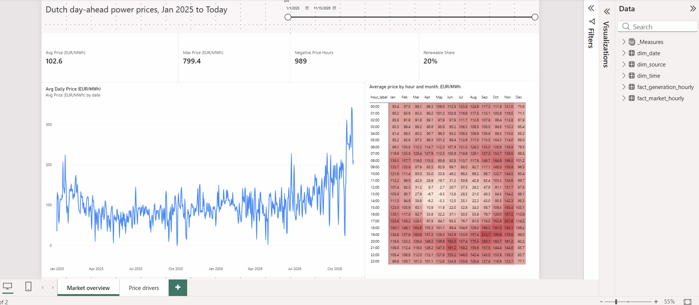
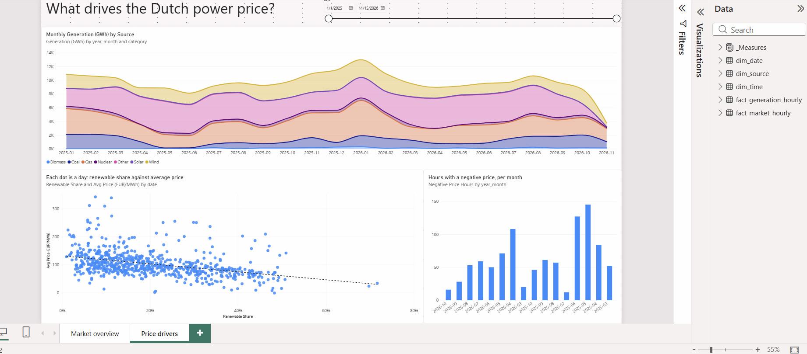
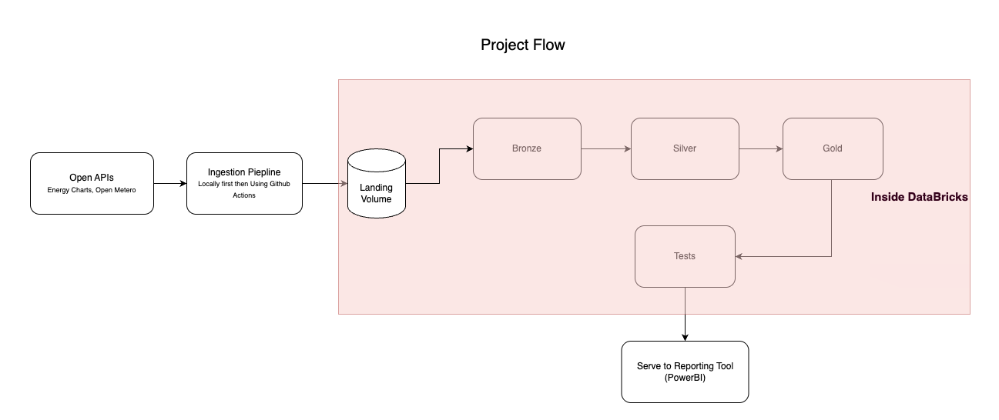
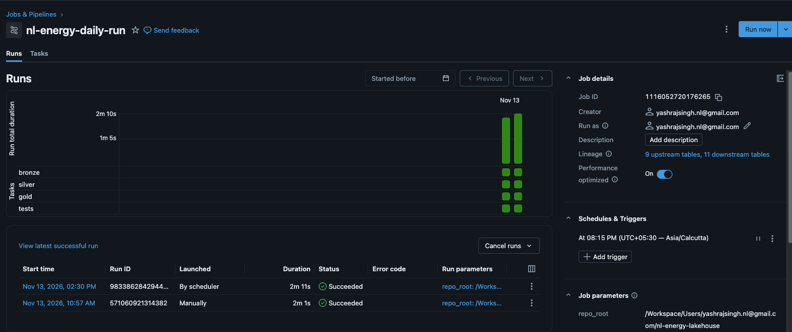
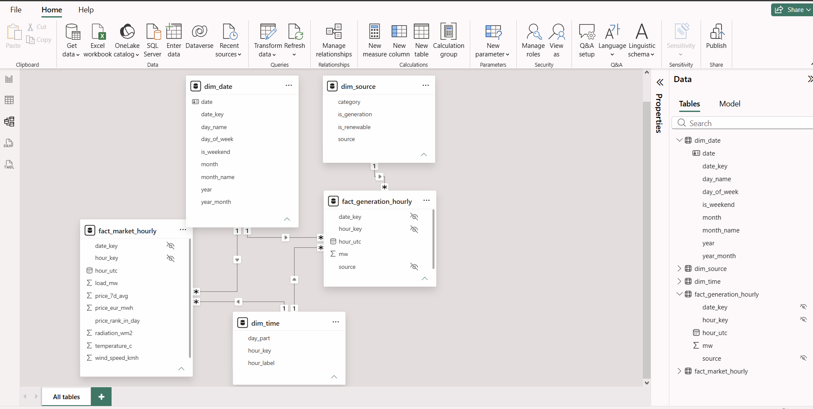

# NL Energy Lakehouse

[](https://github.com/coderajyash/nl-energy-lakehouse/actions/workflows/ci.yml)

I built this project to answer one question: **what makes electricity cheap or expensive
in the Netherlands?**

Every day the pipeline downloads Dutch electricity prices, how much power each source
(wind, solar, gas and so on) produced, and the weather. It cleans the data on Databricks,
checks it, and feeds a Power BI report. It has been running daily on data from
1 January 2025, with no manual steps.

---

## What I found

All numbers are from my data up to 13 November 2026.



### 1. Power is cheapest at lunchtime and most expensive in the evening

On average the cheapest hour of the day is **13:00 at 47.7 EUR/MWh** and the most
expensive is **19:00 at 153.6 EUR/MWh**, about three times more. There is also a smaller
morning peak around 07:00.

### 2. On spring afternoons the price goes below zero

In April and May the average price at 13:00 and 14:00 is negative. This means producers
were paying to get rid of electricity, because there was so much solar power at midday.

| Hour | April | May |
| --- | --- | --- |
| 12:00 | 8.7 | 2.7 |
| 13:00 | **-6.7** | **-8.5** |
| 14:00 | **-6.2** | **-5.3** |
| 15:00 | 10.9 | 11.9 |

*(EUR/MWh, Amsterdam time, April and May of 2025 and 2026 together)*

Over the whole period there were **989 hours** with a negative price, mostly in spring
and early summer.

### 3. Greener days are cheaper days



I split the 682 days into four groups by how much of the power came from renewable
sources:

| Days | Renewable share | Average price (EUR/MWh) |
| --- | --- | --- |
| Least green quarter | 1–10% | 124.3 |
| Second quarter | 10–18% | 111.4 |
| Third quarter | 18–30% | 95.7 |
| Greenest quarter | 30–72% | 78.7 |

On the greenest days power cost about **37% less** than on the least green days.

---

## How it works



In simple steps:

1. **19:00 IST**: a Python script on GitHub Actions downloads the latest data and saves
   the files in Databricks, exactly as they came.
2. **20:15 IST**: a Databricks job processes the files in four steps:
   - **Bronze**: turns the raw files into rows
   - **Silver**: fixes data types and times, and removes duplicates
   - **Gold**: builds the tables the report uses
   - **Checks**: six tests stop the job if something looks wrong
3. **Power BI** reads the gold tables and shows the report.

If any step fails, I get an email.



### Tools

- **Python** to download the data
- **Databricks** (free edition) with **PySpark**, **SQL** and **Delta tables** to process it
- **GitHub Actions** to run the download every day and to test my code on every change
- **Power BI** for the report

### Data used

| Source | What | How often it Updates |
| --- | --- | --- |
| [Energy-Charts](https://api.energy-charts.info) | Electricity prices for the Netherlands | Every 15 minutes |
| [Energy-Charts](https://api.energy-charts.info) | Power produced by each source, and total demand | Every 15 minutes |
| [Open-Meteo](https://open-meteo.com) | Temperature, wind and sunlight at De Bilt | Every hour |

Both are free and need no API key.

---

## The report tables

The gold layer is a small star schema: two tables of numbers in the middle, three
lookup tables around them.



| Table | One row is... |
| --- | --- |
| `fact_market_hourly` | one hour: price, demand and weather |
| `fact_generation_hourly` | one hour for one power source |
| `dim_date` | one day |
| `dim_time` | one hour of the day (00:00 to 23:00) |
| `dim_source` | one power source, and whether it is renewable |

Size on 13 November 2026: about 16,000 hourly rows of prices and 147,000 rows of
generation, built from 915,000 rows of 15-minute generation data.

---

## Problems I encountered and solved in completing the project


**The clock change.**
On 26 October 2025 the clocks in the Netherlands went back an hour, so 02:00–02:45 local
time happened twice. If I had used local time as the key, four prices would have been
overwritten. I store everything in UTC, which never repeats, and keep local time in a
separate column for the report.

**A test caught real missing data.**
One of my checks makes sure every power source is known. On its first run it failed: the
data also contained "Renewable share of load", "Renewable share of generation" and
"Cross border electricity trading". These are not power plants, so I marked them as
non-generation to keep them out of the totals.

**The API limits how often you can call it.**
Energy-Charts allows about two requests per minute. My script waits when the API says
"too many requests", retries when the server has a problem, and splits long date ranges
into months.

**Databricks free edition can't reach the internet freely.**
So the download runs on GitHub Actions instead, and only uploads the files to Databricks.

---

## Data checks

The job stops if any of these finds a problem:

- no hour appears twice
- no hour is missing
- every hour has a price
- prices are between -500 and 4,000 EUR/MWh
- no generation row appears twice
- every power source is listed in `dim_source`

---

## Known limitations

- **Solar seems too low in the source data.** In October 2026 it shows only 23 GWh of
  solar, against 2,533 GWh of gas and 2,109 GWh of wind. The overall renewable share
  comes out at about 20%, which looks too low for the Netherlands. I haven't found the
  cause yet, so I use the renewable share to compare days with each other, not as an
  exact figure.
- **Weather comes from one place** (De Bilt) and arrives about five days late.
- **The Power BI report is a desktop file**, so it updates when I press refresh, not
  automatically.

---

## Folders

```text
.github/workflows/   daily download (ingest.yml) and code checks (ci.yml)
ingestion/           Python code that downloads and uploads the data
notebooks/           Databricks notebooks: bronze, silver, gold, tests
sql/setup/           creates the schemas and tables
sql/gold/            one SQL file per report table
sql/tests/           one SQL file per data check
tests/               tests for the Python code
samples/             example API responses
powerbi/             report file and screenshots
docs/                images for this README
```

---

## Run it yourself

1. Create a free [Databricks](https://docs.databricks.com/aws/en/getting-started/free-edition)
   account and run the files in `sql/setup/`.
2. Load the history:
   ```bash
   python -m venv .venv && source .venv/bin/activate
   pip install -r requirements.txt
   export DATABRICKS_HOST="https://<your-workspace>.cloud.databricks.com"
   export DATABRICKS_TOKEN="<your-token>"
   python -m ingestion.run --start 2025-01-01 --end <today>
   ```
3. Connect this repository to Databricks as a Git folder and run the notebooks
   `01_bronze` to `04_tests`. The last two need a `repo_root` parameter: the path of the
   Git folder.
4. To make it daily, add `DATABRICKS_HOST` and `DATABRICKS_TOKEN` as GitHub secrets and
   create a Databricks job with the four notebooks.
5. Open [`powerbi/Energy_pre_nl.pbix`](powerbi/Energy_pre_nl.pbix) in Power BI Desktop
   and connect it to your own Databricks SQL warehouse.

---

## What's next

- Move the gold tables to **dbt**
- Find out why solar is so low and fix it
- Use more weather stations, including one at sea
- Add a simple forecast of tomorrow's price

---

## Credits

Electricity data from [Energy-Charts](https://energy-charts.info) (Fraunhofer ISE).
Weather data from [Open-Meteo](https://open-meteo.com).
