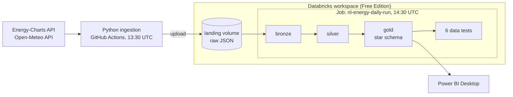
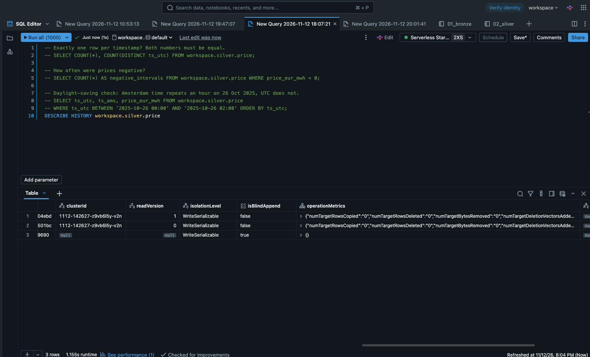
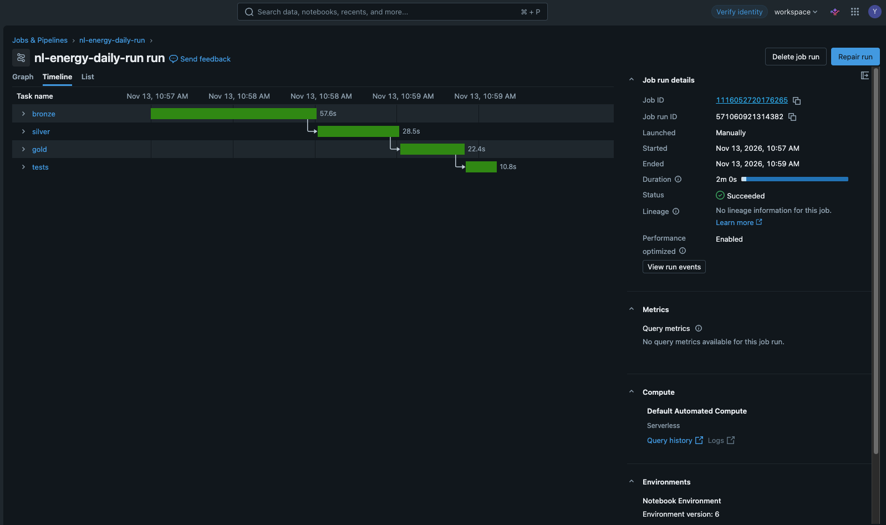

# NL Energy Lakehouse

[](https://github.com/coderajyash/nl-energy-lakehouse/actions/workflows/ci.yml)

A daily batch pipeline on Databricks that collects Dutch day-ahead electricity prices,
generation by source and weather, models them into a tested star schema, and serves a
Power BI report.

The question behind it: **how the wind, sun and demand move the Dutch power price?**

Data runs from 1 January 2025 and updates every day without manual steps.

---

## What the data shows


- Power is cheapest around 13:00 and most expensive around 19:00. Across the whole
  period the average price at 19:00 (153 EUR/MWh) is roughly 3.3 times the price at
  13:00 (47 EUR/MWh).
- In April and May the *average* price between 13:00 and 15:00 is below zero. On a
  typical spring afternoon solar output is high enough that producers pay to deliver.
- 989 hours had a negative price, concentrated in spring and early summer.


- Days with a higher renewable share have lower average prices (trend line in the
  scatter, one dot per day).
- The evening peak is where gas sets the price: the sun is gone and demand is still high.

The report file is [`powerbi/Energy_pre_nl.pbix`](powerbi/Energy_pre_nl.pbix)
(Power BI Desktop, Windows).

---

## Architecture



| Layer | Where it runs | What it does |
| --- | --- | --- |
| Ingestion | GitHub Actions (`ingest.yml`) | Calls both APIs, writes each response unchanged to a Unity Catalog volume |
| Bronze | `notebooks/01_bronze` | Flattens the nested JSON into rows, keeps the source file name for lineage |
| Silver | `notebooks/02_silver` | Casts types, converts to UTC and Amsterdam time, removes duplicates, MERGE upsert |
| Gold | `sql/gold/*.sql` via `notebooks/03_gold` | Star schema: two fact tables, three dimensions |
| Tests | `sql/tests/*.sql` via `notebooks/04_tests` | Six checks; the job fails if any returns rows |
| Report | Power BI Desktop | Two pages built on the gold tables only |

---

## Stack

| Tool | Used for |
| --- | --- |
| Python, `requests`, `databricks-sdk` | API ingestion with retries and rate-limit handling, uploads to the volume |
| Databricks Free Edition | Unity Catalog, serverless compute, jobs, SQL warehouse |
| PySpark, Delta Lake | Bronze and silver layers, MERGE |
| Spark SQL | Gold models and data quality tests |
| GitHub Actions | Daily ingestion and CI (ruff, pytest) |
| Power BI Desktop | Data model, DAX measures, report |

---

## Data sources

| Source | Data | Granularity |
| --- | --- | --- |
| [Energy-Charts](https://api.energy-charts.info) `/price?bzn=NL` | Day-ahead price, EUR/MWh | 15 min (hourly before late 2025) |
| [Energy-Charts](https://api.energy-charts.info) `/public_power?country=nl` | Generation by source and load, MW | 15 min |
| [Open-Meteo archive](https://open-meteo.com) | Temperature, wind speed, solar radiation at De Bilt | Hourly, about 5 days behind |

Neither API needs a key.

---

## Data model


| Table | Grain | Notes |
| --- | --- | --- |
| `fact_market_hourly` | one row per hour (UTC) | price, load, weather, 7-day rolling average price, price rank within the day |
| `fact_generation_hourly` | one row per hour per source | MW averaged over the hour, so the value equals MWh |
| `dim_date` | one row per day | integer `date_key` (yyyymmdd), month, weekday, weekend flag |
| `dim_time` | one row per hour of day | `hour_label`, day/night |
| `dim_source` | one row per source | category, renewable flag, and `is_generation` to keep load, shares and trade out of generation totals |

Facts join to dimensions on Amsterdam-local `date_key` and `hour_key`, so the report
reads in local time while the data itself is keyed on UTC.

---

## How it works

### Ingestion

`python -m ingestion.run` fetches yesterday to tomorrow by default (tomorrow's day-ahead
prices are published around midday). `--start` and `--end` allow backfills; long ranges
are split into calendar months. Energy-Charts allows roughly two requests per minute per
endpoint, so the client honours `429 Retry-After`, retries 5xx responses with a growing
wait, and fails fast on other 4xx errors. Files are overwritten by name, so rerunning a
range never duplicates anything.

Ingestion runs on GitHub rather than in Databricks because Free Edition limits outbound
internet access from notebooks.

### Bronze

The APIs return parallel arrays (`unix_seconds[i]` belongs with `price[i]`).
`posexplode` turns each array into rows while keeping the position, which is then used to
pick the matching timestamp. Each row keeps `_source_file` and `_file_modified`.
Bronze is rebuilt from all files on every run; at this size that takes seconds.

### Silver

- Timestamps are stored in UTC and also as Amsterdam local time. On 26 October 2025 the
  local hour 02:00–02:59 occurs twice; a local-time key would have overwritten four
  15-minute prices.
- When the same timestamp appears in more than one file, the most recently written file wins.
- Rows are written with MERGE on the business key, and only rows whose values changed are
  updated. A second run on the same input inserts and updates zero rows:



### Gold

Each gold table is one `SELECT` in its own file under `sql/gold/`. The `03_gold` notebook
wraps each file in `CREATE OR REPLACE TABLE`. Dimensions sort before facts alphabetically,
which is the order the facts need. Price defines which hours exist; load and weather are
left-joined so a late weather file never drops an hour.

### Data quality tests

Each file in `sql/tests/` returns the rows that break a rule. Zero rows is a pass.

| Test | Rule |
| --- | --- |
| `fact_market_no_duplicates` | one row per hour |
| `fact_market_no_missing_hours` | no gaps between the first and last hour |
| `fact_market_no_null_price` | every hour has a price |
| `price_within_bounds` | price between -500 and 4,000 EUR/MWh |
| `fact_generation_no_duplicates` | one row per hour and source |
| `power_sources_known` | every source in silver is mapped in `dim_source` |

`power_sources_known` failed on the first run: the generation feed also contains
"Renewable share of load", "Renewable share of generation" and "Cross border electricity
trading". They are now mapped as non-generation, so they cannot inflate generation totals.

### Orchestration and CI

| What | Trigger | Runs |
| --- | --- | --- |
| `ingest.yml` | daily 13:30 UTC, or manually | `python -m ingestion.run` with Databricks credentials from repository secrets |
| Databricks job `nl-energy-daily-run` | daily 14:30 UTC | bronze → silver → gold → tests, each task depending on the previous one; email on failure |
| `ci.yml` | every push and pull request | `ruff check .` and `pytest` |



The hour between the two schedules covers GitHub's occasional delays on scheduled runs.
Changes go through pull requests; CI caught Databricks notebooks being linted as plain
Python, which is why `notebooks/` is excluded in `pyproject.toml`.

---

## Report

Two pages, Import mode, built only on gold tables.

- **Market overview**: average and maximum price, negative-price hours, renewable share,
  daily price line, hour-by-month price heatmap, date slicer.
- **Price drivers**: monthly generation mix, renewable share against daily price,
  negative-price hours per month. The date slicer is synced across both pages.

Measures live in a separate `_Measures` table:

```DAX
Avg Price (EUR/MWh)        = AVERAGE(fact_market_hourly[price_eur_mwh])
Max Price (EUR/MWh)        = MAX(fact_market_hourly[price_eur_mwh])
Negative Price Hours       = CALCULATE(COUNTROWS(fact_market_hourly), fact_market_hourly[price_eur_mwh] < 0)
Generation (GWh)           = DIVIDE(SUM(fact_generation_hourly[mw]), 1000)
Renewable Generation (GWh) = CALCULATE([Generation (GWh)], dim_source[is_renewable] = TRUE())
Renewable Share            = DIVIDE([Renewable Generation (GWh)], [Generation (GWh)])
```

Every measure was checked against the same number computed in Databricks SQL.

---

## Known limitations

- **Solar looks under-counted.** Renewable share comes out at about 20%, which is lower
  than published figures for the Netherlands, and October 2026 shows only 23 GWh of solar.
  The midday price dip suggests far more solar on the grid than the series contains.
  I have not yet confirmed whether this is coverage in the source data or a mapping issue.
- **One weather station.** De Bilt stands in for the whole country. Wind farms are mostly
  offshore, so wind speed there is only a proxy; the generation data carries the direct
  wind and solar signal.
- **Bronze is a full rebuild** on every run. Fine at this volume, not at a much larger one.
- **The Power BI report is a desktop file**, not a published service report, and it
  refreshes on demand.

---

## Repository layout

```text
.github/workflows/   ingest.yml (daily ingestion), ci.yml (lint and tests)
ingestion/           http_client, energy_charts, open_meteo, upload, run
notebooks/           01_bronze, 02_silver, 03_gold, 04_tests
sql/setup/           schemas, volume and silver table definitions
sql/gold/            one SELECT per gold table
sql/tests/           one data quality test per file
tests/               pytest unit tests for the ingestion code
samples/             example API responses
powerbi/             report file and screenshots
docs/                images used in this README
```

---

## Running it yourself

1. Create a [Databricks Free Edition](https://docs.databricks.com/aws/en/getting-started/free-edition)
   workspace and run the files in `sql/setup/` in the SQL editor.
2. Create a personal access token, then locally:
   ```bash
   python -m venv .venv && source .venv/bin/activate
   pip install -r requirements.txt
   export DATABRICKS_HOST="https://<your-workspace>.cloud.databricks.com"
   export DATABRICKS_TOKEN="<token>"
   python -m ingestion.run --start 2025-01-01 --end <today>
   ```
3. Add this repository to Databricks as a Git folder and run the four notebooks in order.
   `03_gold` and `04_tests` take a `repo_root` parameter: the full workspace path of the
   Git folder.
4. For automation, add `DATABRICKS_HOST` and `DATABRICKS_TOKEN` as GitHub Actions secrets
   and create a job with the four notebooks as dependent tasks.
5. Open the `.pbix` in Power BI Desktop and point the Databricks connection at your own
   SQL warehouse (server hostname and HTTP path).

Unit tests: `pytest -q`. Lint: `ruff check .`

---

## Next

- Move the gold layer to dbt (`sql/gold` files become models, `sql/tests` become singular tests)
- Define the job as a Databricks Asset Bundle and deploy it from CI
- Auto Loader for incremental bronze
- Several weather points, including one offshore, instead of De Bilt alone
- A next-day price forecast written back to gold

---

## Data credits

Electricity data from [Energy-Charts](https://energy-charts.info) (Fraunhofer ISE); the
licence for each series is stated in the `license_info` field of the API response.
Weather data from [Open-Meteo](https://open-meteo.com).
